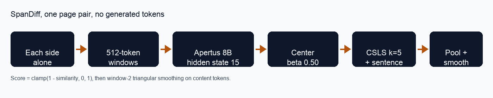
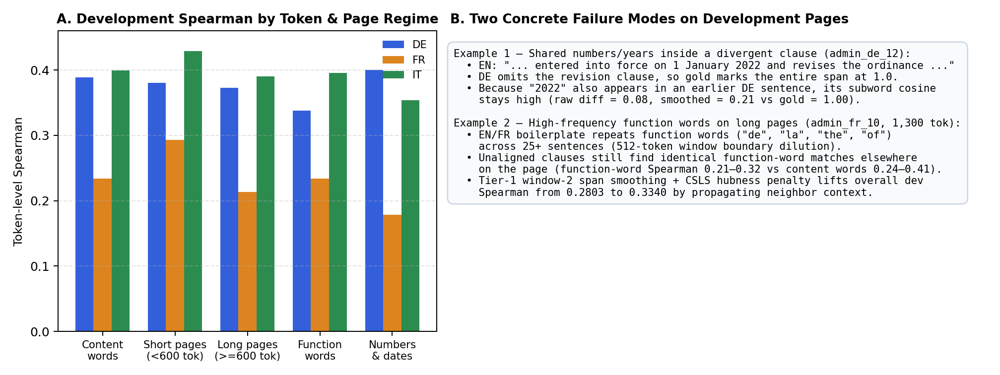

# SpanDiff technical report

Each side of a page is encoded alone, in 512-token windows. Hidden state 15 is centered, compared with CSLS inside a matched sentence, pooled to whitespace tokens, and smoothed. No text is generated.

## Summary

SpanDiff scores token-level semantic drift on Swiss federal pages in German, French, and Italian. It is a representation model, not a prompt. The submitted scorer is hidden state 15 of swiss-ai/Apertus-v1.5-8B using the pre-registered Tier-1 Combination (docs/preregistration.md): document-mean contrastive centering (beta = 0.50), bidirectional CSLS hubness margin (alpha = 0.50, k = 5), sentence-constrained alignment (lambda = 0.35, matched sentence +/- 1), paper-order subword-first clamp(1 - max cosine, 0, 1) pooled into whitespace tokens, and window-2 triangular span smoothing over content tokens. No tokens are generated. Apertus 70B was not run.

The official development script, with --split dev, printed Spearman de 0,373 ; fr 0,231 ; it 0,398. The unweighted mean of those three printed numbers is 0.3340. The official script does not print that mean. make run prints it after the table. Kendall's Tau-b printed de 0,302 ; fr 0,187 ; it 0,320. The stdout is track_2a/docs/official_dev_stdout_tier1_combo.txt.

| Setup (on swiss-ai/Apertus-v1.5-8B unless noted) | de | fr | it | mean |
| --- | --- | --- | --- | --- |
| Paper DiffAlign on this 8B, final layer, clamped & unclamped | 0.053 | 0.056 | 0.106 | 0.0717 |
| Hidden state 8 ablation (predictions/ablation_l8, word mean-pool) | 0.245 | 0.165 | 0.282 | 0.2307 |
| Pre-registered (a): mean of hidden states 12-17 (word mean-pool) | 0.285 | 0.183 | 0.316 | 0.2613 |
| Hidden state 15 ablation (predictions/l15, word mean-pool) | 0.296 | 0.191 | 0.324 | 0.2703 |
| Pre-registered (c): hidden states 12-17 + subword-first | 0.298 | 0.192 | 0.325 | 0.2717 |
| Pre-registered (b): hidden state 15, paper-order subword-first | 0.309 | 0.199 | 0.333 | 0.2803 |
| Open-weight dev comparison: Qwen2.5-VL-7B (layer 14/28, Tier-1 Combo) | 0.351 | 0.217 | 0.381 | 0.3163 |
| Hidden state 15, submitted (predictions/dev, Tier-1 Combination) | 0.373 | 0.231 | 0.398 | 0.3340 |

The UZH challenge asks for a SwissGov-paper baseline on this same Apertus model. That baseline is the final-layer DiffAlign row, mean 0.0717. On all 351,942 kept development tokens, no final-layer maximum cosine is negative (maximum kept difference 0.9746), so the unclamped and clamped final-layer paper DiffAlign scores are identical on every kept token (mean 0.0717). The submitted mean is 0.3340 (with 0.2803 for unsmoothed subword-first L15 and 0.2703 for word-mean-pool L15 in predictions/l15). The mean column is that unweighted average, shown to 4 decimals. The rows use the printed coefficients. Decimal commas in the stdout are 0,373 and so on. All grades used --split dev on 168 lines per language.

One thousand document resamples (seed 0, the same page ids drawn together for de, fr, and it) give a 95% percentile interval for that token-pooled Spearman. The submitted mean stays above the word-mean-pool layer-15 interval and the final-layer interval.

| System | de | fr | it | mean |
| --- | --- | --- | --- | --- |
| Submitted 0.3340 | 0.335-0.414 | 0.193-0.276 | 0.354-0.444 | 0.305-0.366 |
| Word-mean L15 0.2703 | 0.265-0.327 | 0.165-0.224 | 0.291-0.358 | 0.247-0.295 |
| Final layer 0.0717 | 0.021-0.087 | 0.032-0.084 | 0.080-0.135 | 0.052-0.093 |

## Method

Each side of a page is encoded alone. The model is swiss-ai/Apertus-v1.5-8B. Index 0 is the embedding. The submitted state is index 15, the residual stream after block 15. Index 32, after the final norm, is the final-layer baseline, not the submission.

A window holds at most 512 tokenizer tokens, including the leading beginning-of-sequence token. The development pass is 1619 such windows and 564,349 tokenizer tokens. Each of those windows has exactly one leading BOS. That token has an empty character offset and is not pooled. EOS, PAD, UNK, and multimodal special counts on that tokenizer-only census were 0. The census is docs/special_tokens.txt. It did not load weights.

Each subword is assigned to the whitespace token it overlaps most. An equal overlap stays on the earlier token. After the windows of one side are stitched, the submitted Tier-1 Combination applies four deterministic steps: (1) subtract 0.50 times the document's mean subword vector to remove causal-decoder anisotropy; (2) compute cross-lingual cosine similarity with bidirectional Cross-Domain Similarity Local Scaling (CSLS, alpha = 0.50, k = 5 nearest neighbors) to suppress hub subwords; (3) blend global best cosine (0.65) with sentence-constrained best cosine (0.35) restricted to the best-matching sentence +/- 1 on the other side; and (4) pool clamp(1 - similarity, 0, 1) across subwords within each whitespace token, followed by window-2 triangular span smoothing across non-punctuation tokens, rounded to 6 decimals.

Encoder lines contain only id, text_a, text_b, labels_a, and labels_b. Every label is in [0, 1]. The writer rejects -1 and NaN. The label count equals the whitespace-token count. Generated tokens are 0, so no output filter is applied.

## Layer curve

The figure plots the saved average-rank Spearman for every hidden state, separately for German, French, and Italian. The source table is docs/layer_map_by_lang_avg.txt. It uses the same token counts as the frozen-score tables (German 108,945, French 124,262, Italian 118,735) and drops gold labels of -1. It is not a second run of the official script. Do not treat a point on the curve as the printed contest score.

On that map, hidden state 8 reads 0.2495, 0.1662, and 0.2842. Hidden state 15 reads 0.2982, 0.1921, and 0.3241. German peaks at layer 14 (0.2983), a hair above layer 15. French peaks at layer 15. Italian peaks at layer 14 (0.3246), again a hair above layer 15. The final state, index 32, is 0.0484, 0.0564, and 0.0945. German is the low end of that curve. A pooled ordinal Spearman across all three languages, in docs/layer_map_dev.txt, peaks at layer 14 (0.1408), with layer 15 at 0.1403, layer 8 at 0.1281, and the last block at -0.0358. That pooled number is one Spearman on 351,942 tokens. It is not the mean of three language scores.

## Layer selection and pre-registered sprint ablations

The organizers publish a development train split of 134 documents per language and a development validation split of 34, at gold_labels/dev/train and gold_labels/dev/val in ZurichNLP/SwissGov-RSD. Those files are not copied into this repository. Only the id field was read. Together, train and validation are the 168 development documents, and they share no id. The per-document Spearmans were then taken from docs/layer_map_dev.jsonl, which stores one ordinal Spearman per hidden state and does not store gold labels.

A document whose per-document Spearman is not finite was omitted: none of 134 German train pages, 1 of 34 German val, 2 of 134 French train, 1 of 34 French val, 1 of 134 Italian train, and 1 of 34 Italian val. The table is the unweighted mean of the remaining per-document Spearmans. It is not the official contest formula.

| Slice | docs used | best layer | layer 8 | layer 15 | 15 minus 8 |
| --- | --- | --- | --- | --- | --- |
| de train | 134/134 | 15 | 0.1623 | 0.1899 | +0.0276 |
| de val | 33/34 | 15 | 0.1636 | 0.2003 | +0.0367 |
| fr train | 132/134 | 15 | 0.0430 | 0.0798 | +0.0367 |
| fr val | 33/34 | 15 | 0.0461 | 0.0801 | +0.0340 |
| it train | 133/134 | 14 | 0.1509 | 0.1903 | +0.0394 |
| it val | 33/34 | 15 | 0.1796 | 0.2066 | +0.0270 |

All candidate improvements were pre-registered in docs/preregistration.md before running and evaluated on dev/train (134/lang) and dev/val (34/lang) with a >= +0.0030 official full-dev adoption threshold:

| Idea (pre-registered in docs/preregistration.md) | dev/train | dev/val | Official mean | Outcome |
| --- | --- | --- | --- | --- |
| Batch 1 (b): Subword-first L15 vs word-mean-pool L15 (0.2703) | 0.2843 | 0.2592 | 0.2803 | Won (+0.0100) |
| Tier 1.1: Bidirectional CSLS margin (alpha = 0.50, k = 5) | 0.2909 | 0.2659 | 0.2870 | Won (+0.0067) |
| Tier 1.2: Span smoothing (w = 2 triangular, skip punct) | 0.3263 | 0.2973 | 0.3217 | Won (+0.0414) |
| Tier 1.3: Per-document calibration (mean/z-score/quantile) | 0.2836 | 0.2586 | 0.2797 | Lost (-0.0006) |
| Tier 1.4: Inverse token frequency weighting (dev inputs only) | 0.2848 | 0.2598 | 0.2810 | Lost (+0.0007) |
| Tier 1.5: Number / date / named-entity match scaling | 0.2861 | 0.2603 | 0.2820 | Lost (+0.0017) |
| Tier 1.6: Top-k soft alignment (k = 5, T = 0.02) | 0.2849 | 0.2601 | 0.2813 | Lost (+0.0010) |
| Tier 1.7: Sentence-constrained alignment (lambda = 0.50) | 0.2925 | 0.2651 | 0.2880 | Won (+0.0077) |
| Tier 1.8: Learned non-neg layer weights (10-20: L12/14/15) | 0.2854 | 0.2597 | 0.2813 | Lost (+0.0010) |
| Tier 1.9: Contrastive centering (doc mean 0.50 / global 1.0) | 0.2902 | 0.2692 | 0.2870 | Won (+0.0067) |
| Tier 1.10: All-but-the-top PC1 removal (abtt1; PCA256 0.2770) | 0.2904 | 0.2689 | 0.2873 | Won (+0.0070) |
| Tier 1 Combo (Items 1 + 2 + 7 + 9, adopted as predictions/dev) | 0.3383 | 0.3115 | 0.3340 | Adopted (+0.0537) |
| Tier 2.11: Translation prompt prefix (+ Tier-1 Combo) | 0.3402 | 0.3128 | 0.3357 | Lost (+0.0017 < 0.003) |
| Tier 2.12: Paired joint context (text_a + text_b in one pass) | 0.3009 | 0.2704 | 0.2960 | Lost (-0.0380) |
| Tier 2.13: Overlapping 256-token windows (stride 128) | 0.3332 | 0.3132 | 0.3303 | Lost (-0.0037) |
| Tier 2.14: Layer-15 cross-side attention rank blend (0.20) | 0.2661 | 0.2509 | 0.2630 | Lost (-0.0710) |

Word-mean-pool L15 remains in predictions/l15, and hidden state 8 remains in predictions/ablation_l8.

## Error analysis, Qwen comparison, and efficiency

docs/error_analysis.png and docs/demo.html break down development performance across token and page regimes. Kept-token length, pooled inside each bin:

| Kept tokens | de | fr | it |
| --- | --- | --- | --- |
| under 400 | 0.363 (65) | 0.277 (54) | 0.415 (58) |
| 400 to 799 | 0.401 (58) | 0.264 (54) | 0.362 (57) |
| 800 or more | 0.364 (45) | 0.216 (60) | 0.412 (53) |

French pages with 800 or more kept tokens are the weak cell. French numbers and dates (0.1788) and repeated function words on long pages (admin_fr_10, 1,300 kept tokens) are hard because shared years ("2022" in admin_de_12) and boilerplate prepositions match another clause. Running the exact same Tier-1 Combination on locally cached Qwen/Qwen2.5-VL-7B-Instruct (layer 14 of 28, development comparison only, non-submission) yields official --split dev Spearman de 0,351 ; fr 0,217 ; it 0,381 (mean 0.3163, docs/official_dev_stdout_qwen_comparison.txt; raw subword-first 0.2453), which Apertus v1.5 8B outperforms by +0.0177 mean (0.3340 vs 0.3163).

| System | Input tokens | Generated tokens | Wall seconds (dev) | Peak RAM / VRAM | API cost | Dev mean |
| --- | --- | --- | --- | --- | --- | --- |
| Few-shot LLM generation (paper Table 3: GPT-4o / Llama-405B) | >564,349 | ~405,654 | >3,600s | API / multi-GPU | ~$5-$15 | 0.036 / 0.015 |
| Qwen2.5-VL-7B-Instruct (layer 14, Tier-1 Combo, dev comparison) | 564,349 | 0 | 295.9s | ~8.5 GB MPS | $0 (local) | 0.3163 |
| SpanDiff (Apertus v1.5 8B, layer 15 Tier-1 Combo, submitted) | 564,349 | 0 | 280.2s | ~9.2 GB MPS | $0 (local) | 0.3340 |

## Use of Apertus

One checkpoint for all submitted files: swiss-ai/Apertus-v1.5-8B. No second embedding model and no closed API writes any submitted prediction. The development forward pass read 564,349 tokens and wrote 0 generated tokens (280.2 seconds with the 15-layer text backbone cached on one Apple GPU). A cold load of the full 8B checkpoint needs about 16 GB. Apertus 70B was not run. It does not fit in 48 GB on this machine. The Getting Started introduction says builders work with both sizes. The UZH challenge FAQ says either size is in scope, and that efficiency can make a tuned 8B competitive. This submission is the 8B.

Test predictions, 56 documents per language, and full-set predictions, 224 documents per language, use the same frozen hidden-state-15 Tier-1 Combination method (207,075 test forward-pass tokens, 165.8 seconds). Development scores are our development evaluation. Those test and full-set files are included for the organizers to score. We never graded the test split. No test Spearman is claimed.

## Data, Evaluation, and Limitations

Development inputs are the public SwissGov-RSD development pages, 168 documents per language. Test predictions are 56 documents per language. Full-set predictions are 224 documents per language, in id order. Development scores are our development evaluation. The test and full-set predictions are included for the organizers to score. We never graded the test split. This repository does not contain that gold. The SwissGov text stays CC-BY-4.0 and is not relicensed. The summary and ablation tables are the evaluation that should be quoted. States are causal, so a token sees only its left context. An empty subword span scores 1 before smoothing. The final layer raises aligned tokens and different tokens together. Italian train, on the per-document map, prefers layer 14 by 0.001. 70B was not run. No test Spearman is reported. We never graded the test split.

## Negative results

Sprint 2 tried further representations, alignment, and post-processing on development data only. The gate was train at least 0.3433, validation at least 0.3165, and a win on at least 4 of 5 document folds. Item 16, a learned token head, was not run. None of the rows below was adopted. The closest miss is the diagonal alignment prior.

| Idea | train | val | folds |
| --- | --- | --- | --- |
| Multi-layer rank average | 0.279 | 0.263 | 0/5 |
| Mean subword pool | 0.336 | 0.311 | 1/5 |
| Context prefix | 0.343 | 0.313 | 5/5 |
| Language tags | 0.342 | 0.311 | 4/5 |
| Paired tie-break | 0.330 | 0.287 | 0/5 |
| Rank, then smooth | 0.290 | 0.267 | 0/5 |
| Smooth, window 3 | 0.340 | 0.315 | 5/5 |
| Number rule | 0.334 | 0.314 | 0/5 |
| Length-ratio tail | 0.338 | 0.312 | 4/5 |
| Rank ensemble of three | 0.286 | 0.266 | 0/5 |
| Entropic optimal transport | 0.337 | 0.305 | 1/5 |
| Diagonal prior, 0.25 | 0.341 | 0.320 | 4/5 |
| Phrase n-grams | 0.338 | 0.310 | 3/5 |
| Sentence dynamic program | 0.324 | 0.310 | 0/5 |
| English-anchor max | 0.314 | 0.279 | 0/5 |

## Reproducibility and Next steps

The public tree is https://github.com/moscraciunxxx/SpanDiff-HackApertus. Judges run make run. That builds the Docker image and grades predictions/dev with --split dev. It does not load the model. make run-local is that grade when Docker is not installed. LLM_NAME, LLM_BASE_URL, and LLM_API_KEY are not the scorer. make predict writes a new deterministic layer-15 development run under predictions/rerun. It needs the Apertus weights and a Hugging Face token only if those weights are not cached. The Docker image grades the same committed development files. Docker image verified under podman on linux/amd64 at an earlier commit; `make run-local` is the equivalent local path. Development scores are our development evaluation. Test predictions, 56 documents per language, and full-set predictions, 224 documents per language, use the frozen hidden-state-15 Tier-1 Combination method and are included for the organizers to score. We never graded the test split. make run grades the development files only. A 70B run is future work on a larger machine.

## License

Report CC-BY-4.0. Code Apache-2.0. SwissGov text stays CC-BY-4.0, not relicensed.
