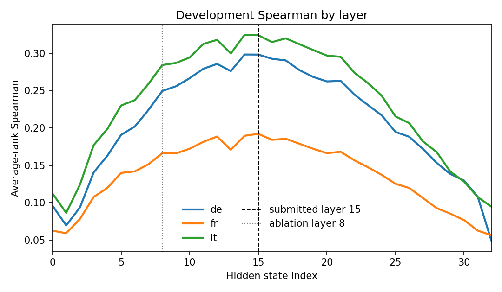

# SpanDiff technical report

## Summary

SpanDiff scores token-level semantic drift on Swiss federal pages in German, French, and Italian. It is a representation model, not a prompt. The submitted scorer is hidden state 15 of swiss-ai/Apertus-v1.5-8B. Subword states are mean-pooled onto whitespace tokens. The score is clamp(1 - max cosine to the other side, 0, 1). No tokens are generated. Apertus 70B was not run.

The official development script, with --split dev, printed Spearman de 0,296 ; fr 0,191 ; it 0,324. The unweighted mean of those three printed numbers is 0.2703. The official script does not print that mean. make run prints it after the table. Kendall's Tau-b printed de 0,238 ; fr 0,154 ; it 0,259. The stdout is track_2a/docs/official_dev_stdout_L15.txt.

| Setup | de | fr | it | mean |
| --- | --- | --- | --- | --- |
| Paper DiffAlign on this 8B, final layer, clamped | 0.053 | 0.056 | 0.106 | 0.0717 |
| Hidden state 8 ablation | 0.245 | 0.165 | 0.282 | 0.2307 |
| Hidden state 15, submitted | 0.296 | 0.191 | 0.324 | 0.2703 |

The UZH challenge asks for a SwissGov-paper baseline on this same Apertus model. That baseline is the clamped final-layer row, mean 0.0717. The submitted mean is 0.2703. The mean column is that unweighted average, shown to 4 decimals. The rows use the printed coefficients. Decimal commas in the stdout are 0,296 and so on. Hidden state 8 is docs/official_dev_stdout.txt. The final layer is docs/official_dev_stdout_last.txt. All three grades used --split dev on 168 lines per language.

## Method

Each side of a page is encoded alone. The model is swiss-ai/Apertus-v1.5-8B. Index 0 is the embedding. The submitted state is index 15, the residual stream after block 15. Index 32, after the final norm, is the final-layer baseline, not the submission.

A window holds at most 512 tokenizer tokens, including the leading beginning-of-sequence token. The development pass is 1619 such windows and 564,349 tokenizer tokens. Each of those windows has exactly one leading BOS. That token has an empty character offset and is not pooled. EOS, PAD, UNK, and multimodal special counts on that tokenizer-only census were 0. The census is docs/special_tokens.txt. It did not load weights.

Subwords are mean-pooled into the whitespace token they overlap most. An equal overlap stays on the earlier token. A whitespace token with no subword becomes a zero vector. Its cosine is defined as 0, so its score is 1. After the windows of one side are stitched, each token is scored against the other side's full sequence. The written score is clamp(1 - max cosine, 0, 1), rounded to 6 decimals.

The paper's DiffAlign takes the final hidden state and does not clamp, so a negative cosine can score above 1. SpanDiff clamps. The final-layer row in the table is the clamped version of that recipe on this 8B model. An unclamped rescore of the saved final-layer states was not produced. The paper also takes the maximum at subword level and then averages inside the word. SpanDiff pools the states first and then takes the maximum. The graded files keep that order.

Encoder lines contain only id, text_a, text_b, labels_a, and labels_b. Every label is in [0, 1]. The writer rejects -1 and NaN. The label count equals the whitespace-token count. Generated tokens are 0, so no output filter is applied.

## Layer curve

The figure plots the saved average-rank Spearman for every hidden state, separately for German, French, and Italian. The source table is docs/layer_map_by_lang_avg.txt. It uses the same token counts as the frozen-score tables (German 108,945, French 124,262, Italian 118,735) and drops gold labels of -1. It is not a second run of the official script. Do not treat a point on the curve as the printed contest score.

On that map, hidden state 8 reads 0.2495, 0.1662, and 0.2842. Hidden state 15 reads 0.2982, 0.1921, and 0.3241. German peaks at layer 14 (0.2983), a hair above layer 15. French peaks at layer 15. Italian peaks at layer 14 (0.3246), again a hair above layer 15. The final state, index 32, is 0.0484, 0.0564, and 0.0945. German is the low end of that curve. A pooled ordinal Spearman across all three languages, in docs/layer_map_dev.txt, peaks at layer 14 (0.1408), with layer 15 at 0.1403, layer 8 at 0.1281, and the last block at -0.0358. That pooled number is one Spearman on 351,942 tokens. It is not the mean of three language scores.

The official prints sit next to this map, not on top of it. Hidden state 15 printed 0,296 ; 0,191 ; 0,324. Hidden state 8 printed 0,245 ; 0,165 ; 0,282. The final layer printed 0,053 ; 0,056 ; 0,106. The shape agrees: the middle of the network carries the signal, and the final state does not.

docs/token_heatmap.png shows one short development pair, admin_de_105, from the submitted layer-15 file. English and German tokens are colored by the clamped difference. It is an illustration, not a score.

## Layer selection

The organizers publish a development train split of 134 documents per language and a development validation split of 34, at gold_labels/dev/train and gold_labels/dev/val in ZurichNLP/SwissGov-RSD. Those files are not copied into this repository. Only the id field was read. Together, train and validation are the 168 development documents, and they share no id. The per-document Spearmans were then taken from docs/layer_map_dev.jsonl, which stores one ordinal Spearman per hidden state and does not store gold labels.

A document whose per-document Spearman is not finite was omitted: none of 134 German train pages, 1 of 34 German val, 2 of 134 French train, 1 of 34 French val, 1 of 134 Italian train, and 1 of 34 Italian val. The table is the unweighted mean of the remaining per-document Spearmans. It is not the official contest formula.

| Slice | docs used | best layer | layer 8 | layer 15 | 15 minus 8 |
| --- | --- | --- | --- | --- | --- |
| de train | 134/134 | 15 | 0.1623 | 0.1899 | +0.0276 |
| de val | 33/34 | 15 | 0.1636 | 0.2003 | +0.0367 |
| fr train | 132/134 | 15 | 0.0430 | 0.0798 | +0.0367 |
| fr val | 33/34 | 15 | 0.0461 | 0.0801 | +0.0340 |
| it train | 133/134 | 14 | 0.1509 | 0.1903 | +0.0394 |
| it val | 33/34 | 15 | 0.1796 | 0.2066 | +0.0270 |

Italian train is the exception. Its best layer is 14, at 0.1913, and layer 15 is 0.1903. An n-weighted mean of the same per-document values picks the same best layer in every row, including Italian train at layer 14. Layer 15 beats layer 8 by about 0.03 on every slice.

Layer 15 was then re-scored on all 168 development documents per language and graded with the official script. That grade, not the per-document map, is the submission. predictions/l15 is a byte-identical copy of predictions/dev. The grade uses predictions/dev only. Hidden state 8 remains in predictions/ablation_l8.

## Use of Apertus

One checkpoint: swiss-ai/Apertus-v1.5-8B. No second embedding model and no closed API. The development forward pass read 564,349 tokens and wrote 0 generated tokens. With the weights already cached, layer-15 scoring took 515 seconds on one Apple GPU. A cold load of the 8B weights needs about 16 GB. Apertus 70B was not run. It does not fit in 48 GB on this machine. The Getting Started introduction says builders work with both sizes. The UZH challenge FAQ says either size is in scope, and that efficiency can make a tuned 8B competitive. This submission is the 8B.

Test predictions, 56 documents per language, and full-set predictions, 224 documents per language, use the same frozen hidden-state-15 method. The test forward pass was 207,075 tokens and 273 seconds. Development scores are our development evaluation. Those test and full-set files are included for the organizers to score. We never graded the test split. No test Spearman is claimed.

## Data

Development inputs are the public SwissGov-RSD development pages, 168 documents per language. Test predictions are 56 documents per language. Full-set predictions are 224 documents per language, in id order. Development scores are our development evaluation. The test and full-set predictions are included for the organizers to score. We never graded the test split. This repository does not contain that gold. The SwissGov text stays CC-BY-4.0 and is not relicensed.

## Evaluation

The summary table is the evaluation that should be quoted. It has three official development runs and no others. Layer-map numbers in the selection section answer why hidden state 15 was scored. They are not a substitute for the printed row.

## Limitations

States are causal, so a token sees only its left context. An empty subword span scores 1, which inflates a few punctuation tokens. The final layer raises aligned tokens and different tokens together, so a last-layer DiffAlign score looks large and ranks poorly. Italian train, on the per-document map, prefers layer 14 by 0.001. The submitted choice is still layer 15 because validation prefers it in all three languages and the official development grade prefers it to layer 8. The unclamped paper formula was not rerun. 70B was not run. No test Spearman is reported. We never graded the test split.

## Reproducibility

The public tree is https://github.com/moscraciunxxx/SpanDiff-HackApertus. Judges run make run. That builds the Docker image and grades predictions/dev with --split dev. It does not load the model. make run-local is that grade when Docker is not installed. LLM_NAME, LLM_BASE_URL, and LLM_API_KEY are not the scorer. make predict writes a new layer-15 development run under predictions/rerun. It needs the Apertus weights and a Hugging Face token only if those weights are not cached. The Docker image grades the same committed development files. An earlier image was built and graded under podman on linux/amd64. Docker is not installed on this Mac, so the current image has not been rebuilt here.

## Next steps

Development scores are our development evaluation. Test predictions, 56 documents per language, and full-set predictions, 224 documents per language, use the frozen hidden-state-15 method and are included for the organizers to score. We never graded the test split. make run grades the development files only. A 70B run is future work on a larger machine.

## License

Report CC-BY-4.0. Code Apache-2.0. SwissGov text stays CC-BY-4.0, not relicensed.
